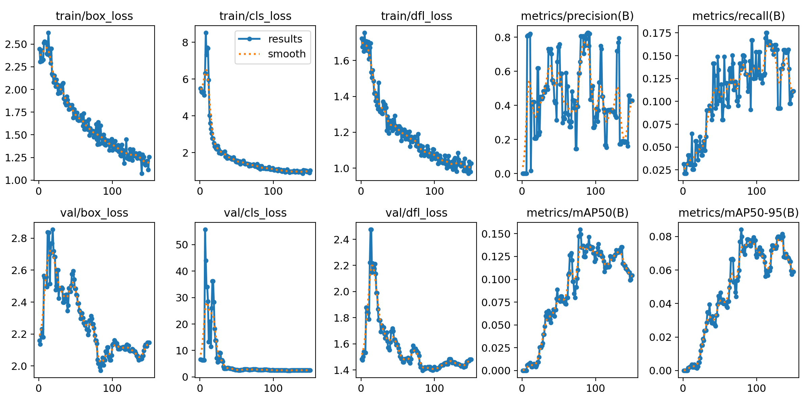
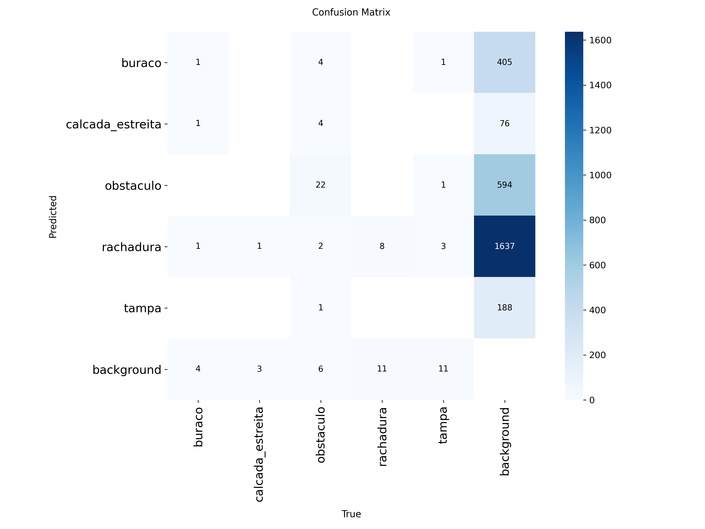

# Auditoria de Calçadas com YOLOv8n no celular

**Checkpoint CPZÃO (CP2 + CP3) — Visão Computacional · FIAP**

| Integrante | RM |
|---|---|
| Kayky Oliveira Schunck | 99756 |

Pipeline completo de visão computacional para auditar calçadas: coleta de fotos reais, rotulagem, treino de um detector YOLOv8n e inferência em tempo real na câmera traseira do celular, rodando 100% no aparelho (*edge computing*).

---

## 1. O problema

Calçadas esburacadas, rachadas ou ocupadas por obstáculos obrigam o pedestre a andar na rua e são perigosas principalmente para idosos, pessoas com deficiência visual, cadeirantes e quem empurra carrinho. Hoje a auditoria é manual: alguém percorre a calçada e anota cada problema.

Este projeto se baseia na metodologia da [Auditoria Cidadã de Calçadas](https://falzoni.com.br/auditoriacalcadas/) (bairro do Brás, São Paulo), que avaliou estado de conservação, obstáculos e acessibilidade de calçadas e travessias. A ideia é que o celular faça a primeira triagem: aponta-se a câmera para a calçada e o modelo marca os problemas.

## 2. Classes escolhidas

| Classe | O que marca | Eixo da auditoria |
|---|---|---|
| `buraco` | buraco ou pedaço faltando no piso | conservação |
| `rachadura` | fenda/linha de quebra no piso | conservação |
| `obstaculo` | poste, cadeira, caixas, vasos, mercadoria na passagem | obstrução |
| `tampa` | tampas de concreto/metal, bueiros, bocas de lobo | risco de tropeço |
| `calcada_estreita` | trecho de passagem livre estreito demais para cadeira de rodas | acessibilidade |

## 3. Dataset

- **Fonte:** fotos de rua do [Mapillary](https://www.mapillary.com) publicadas pelo gabinete da vereadora Renata Falzoni (usuário `gabinete_falzoni`, Brás/SP, novembro de 2025), baixadas com [`notebooks/01_coleta_mapillary.ipynb`](notebooks/01_coleta_mapillary.ipynb).
- **Curadoria:** das 300 fotos sorteadas, **65 foram escolhidas manualmente** por mostrarem defeitos e obstáculos reais (buracos tapados com madeira, tampas de concreto perigosas, cadeiras e caixas na passagem, calçadas estreitas etc.).
- **Rotulagem:** no Roboflow. As caixas foram pré-geradas pelo *Auto Label* (LLM multimodal) com descrições adaptadas à calçada brasileira (ex.: "ignorar as juntas regulares do mosaico de pedra portuguesa") e **revisadas manualmente imagem por imagem**. 63 imagens aprovadas, 2 rejeitadas.
- **Divisão:** 70/20/10, com semente fixa (42).

| Split | Imagens | Caixas |
|---|---|---|
| train | 44 | 248 |
| valid | 13 | 85 |
| test | 6 | 42 |
| **total** | **63** | **375** |

| Classe | Caixas |
|---|---|
| obstaculo | 152 |
| rachadura | 94 |
| tampa | 60 |
| buraco | 50 |
| calcada_estreita | 19 |

## 4. Treinamento

Notebook: [`notebooks/02_treino_yolov8.ipynb`](notebooks/02_treino_yolov8.ipynb) (Google Colab, GPU T4).

- **Modelo:** YOLOv8n (CNN de ~3 milhões de parâmetros, PyTorch/Ultralytics), com *transfer learning* a partir dos pesos pré-treinados no COCO.
- **Escolha da resolução:** o app de referência roda modelos em 192×192. Testamos as duas resoluções:

| Experimento | imgsz | Épocas | Precision | Recall | mAP@50 | mAP@50-95 |
|---|---|---|---|---|---|---|
| 1 | 192 | 65 (early stopping) | 0,907 | 0,044 | 0,062 | 0,040 |
| **2 (adotado)** | **320** | 150 | 0,657 | **0,135** | **0,152** | **0,082** |

*(conjunto de validação)*

Em 192×192, rachaduras e tampas ocupam poucos pixels e o modelo praticamente não as detectava. Em 320 o mAP@50 aumentou cerca de 2,5×, então adotamos 320 e adaptamos o app para essa entrada.

## 5. Métricas (conjunto de teste)

| Classe | Precision | Recall | mAP@50 | mAP@50-95 |
|---|---|---|---|---|
| **all** | **0,880** | **0,108** | **0,206** | **0,103** |
| obstaculo | 0,671 | 0,292 | 0,485 | 0,239 |
| buraco | 0,731 | 0,250 | 0,265 | 0,130 |
| tampa | 1,000 | 0,000 | 0,256 | 0,142 |
| calcada_estreita | 1,000 | 0,000 | 0,019 | 0,002 |
| rachadura | 1,000 | 0,000 | 0,006 | 0,001 |

**Curvas de treino e validação**



**Matriz de confusão (validação)**



### Análise

- **Perdas:** as perdas de treino (box, cls, dfl) caem continuamente até a época 150. As de validação caem até a época 80–90 e depois sobem levemente, enquanto o mAP@50 de validação atinge seu pico nessa mesma faixa. Isso indica **início de overfitting**, esperado com só 44 imagens de treino. O modelo usado (`best.pt`) é o checkpoint de melhor validação.
- **Precision alta, recall baixo:** quando o modelo dispara, costuma acertar (P = 0,88), mas deixa passar a maior parte dos objetos (R = 0,11). Por isso o app usa limiar de confiança 0,25 em vez de 0,35.
- **Melhor classe, `obstaculo` (mAP@50 0,49):** é a classe com mais exemplos e tem objetos grandes e bem definidos (postes, cadeiras), parecidos com classes que o YOLO já conhecia do COCO.
- **Piores classes, `rachadura` e `calcada_estreita`:** rachaduras são finas e longas, viram poucos pixels e se confundem com juntas e texturas do piso; a matriz mostra muitos falsos positivos de `rachadura` sobre o fundo. `calcada_estreita` não é um objeto, e sim uma característica da cena: a caixa é ambígua e há só 19 exemplos.
- **Erro dominante:** objeto → *background* (objetos não detectados), e não troca entre classes. `obstaculo` acerta 22 de 39 na validação; `tampa` e `rachadura` perdem 11 cada para o fundo.
- **Limitações:** dataset pequeno (o teste tem só 6 imagens, então as métricas têm alta variância), rótulos pré-gerados por IA e fotos de um único bairro.

## 6. Deploy mobile

O app fica em [`app/`](app/) e é uma adaptação do [yoloinferApp](https://github.com/Mjrovai/yoloinferApp) de Marcelo Rovai: um PWA (Vite + JavaScript + ONNX Runtime Web) em que o modelo roda **no próprio navegador do celular**, sem servidor, usando a câmera traseira.

**Adaptações feitas no app:**
- Entrada do modelo generalizada de 192×192 fixo para a constante `INPUT_SIZE = 320` (`src/inference.js`), usada no pré-processamento, no pós-processamento e na conversão de coordenadas (`src/main.js`).
- Nomes das classes trocados de `box`/`wheel` para as 5 classes do projeto, na ordem do `data.yaml`.
- Modelo padrão `public/models/calcadas_320.onnx` carregado ao abrir o app.
- Limiar de confiança inicial 0,25, título "Auditoria de Calçadas" e menu restrito à detecção (os modelos de pose e segmentação originais eram 192×192).
- *Service worker* com cache novo (`calcadas-v1`), para o celular não reaproveitar o app antigo, e manifesto PWA renomeado.

**Modelo:** `app/public/models/calcadas_320.onnx` (YOLOv8n, entrada `[1, 3, 320, 320]`, saída `[1, 9, 2100]`, ~12 MB).

### Como rodar no computador

Requisito: [Node.js LTS](https://nodejs.org).

```bash
cd app
npm install
npm run dev
```

Abra o endereço `https://...:5173` que aparece no terminal e aceite o aviso de certificado. A câmera exige HTTPS, e o Vite gera um certificado local.

### Como rodar no celular (iPhone/Android)

```bash
cd app
npm run build
```

Publique a pasta `app/dist` no [Netlify](https://app.netlify.com/drop), arrastando a pasta para a página do Netlify Drop. O Netlify fornece HTTPS automaticamente, o que é obrigatório para a câmera no iOS. Abra o link no Safari, toque em **📷 Start** e aponte para a calçada. Para instalar como app, use **Compartilhar → Adicionar à Tela de Início**.

> Se o celular mostrar uma versão antiga depois de atualizar o modelo, abra o link numa aba privada (o *service worker* faz cache agressivo).

## 7. Estrutura do repositório

```
├── README.md
├── assets/                        # gráficos do treino usados no README
├── notebooks/
│   ├── 01_coleta_mapillary.ipynb  # download das fotos do Mapillary
│   └── 02_treino_yolov8.ipynb     # dataset, treino, métricas e exportação ONNX
└── app/                           # yoloinferApp adaptado (PWA)
    ├── public/models/calcadas_320.onnx
    └── src/ (inference.js, main.js)
```

## 8. Trabalho futuro

- Mais imagens e *data augmentation* para reduzir o overfitting e subir o recall.
- Avaliar 416/640 de entrada contra o FPS no celular.
- Substituir `calcada_estreita` por **segmentação** da calçada e da guia para medir a largura útil de verdade.
- Incluir elementos de acessibilidade (`piso_tatil`, `rampa`).
- Usar o GPS das fotos do Mapillary para gerar automaticamente o mapa de problemas, como no projeto de referência.

## Créditos

- Metodologia e imagens: [Auditoria Cidadã de Calçadas](https://falzoni.com.br/auditoriacalcadas/), gabinete da vereadora Renata Falzoni.
- App base: [yoloinferApp](https://github.com/Mjrovai/yoloinferApp), Marcelo Rovai (licença MIT).
- Detector: [Ultralytics YOLOv8](https://github.com/ultralytics/ultralytics).
